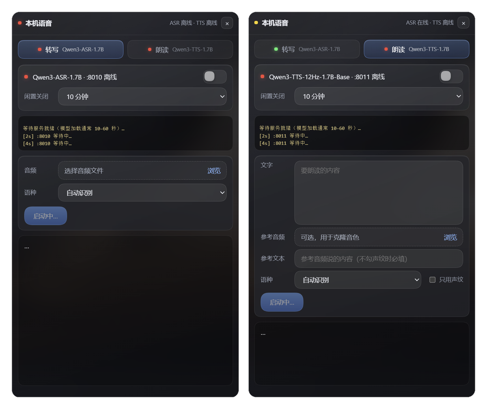
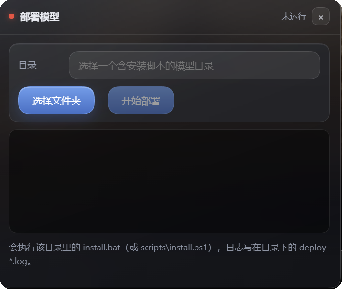
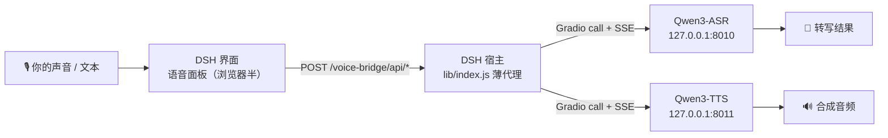

# local-voice-oneclick · 本地语音一键部署

> **对着麦克风说一句，文字直接落进 AI 对话的输入框；选中一段回复，点一下就能听。**
> 转写和合成都在你自己的显卡上完成——音频不出本机，一行都不上传。

[](#环境要求)
[](#环境要求)
[](#它由三块组成)
[](#它由三块组成)
[](LICENSE)

<p align="center">
  
</p>

<p align="center"><sub>左：转写（ASR）　右：朗读（TTS，参考音频音色克隆）　——截图是冷启动瞬间，服务还是「等待中」</sub></p>

---

## 30 秒看懂

- **说话 → 文字**：选一个音频文件（或录好的语音），中文、粤语、方言混说、中英混说都能转，逐字输出。
- **文字 → 声音**：给一段 3–15 秒的参考音频，就能用那个音色念你的文本，**不用训练、不用微调**。
- **接进对话流**：不是独立 App，是 DeepSeek Harness 输入框旁边多出来的一颗「语音」胶囊，点开即用。
- **全离线**：两个服务只监听 `127.0.0.1`，模型、语音、文本都留在这台机器上。
- **一条命令装完**：`install.bat` 自带 Python 3.11 + PyTorch CUDA，不污染你系统里已有的任何环境。

实测（RTX 5070 Ti Laptop / 12 GB 显存）：

| 场景 | 结果 |
| --- | --- |
| 一句中文转写 | **13.8 秒**，逐字正确 |
| 一句中文合成（参考音色，预热后） | **7.8 秒** |
| 闭环验证：合成 → 再转写回来 | 与原文**完全一致** |

---

## 环境要求

| 项 | 要求 |
| --- | --- |
| 系统 | Windows 10 / 11，64 位（两个安装脚本都做环境自检，不满足会直接说缺什么） |
| 显卡 | NVIDIA，CUDA 12.8 可用；**显存 8 GB 起，12 GB 更稳**（ASR ~4 GB + TTS ~5–6 GB） |
| 驱动 | 建议 ≥ 550（`nvidia-smi` 能看到卡和 CUDA 版本） |
| 磁盘 | 至少 25 GB 空闲（两个包各约 10 GB，外加下载缓存） |
| 内存 | 16 GB 起 |
| 网络 | 首次安装要联网（Python / PyTorch / 模型都走国内镜像）；装完可断网使用 |

---

## 为什么不是"又一个语音输入法"

市面上的语音工具大多停在"把话说成字"这一步，然后你自己复制粘贴。这个项目解决的是另外三个问题：

1. **它长在对话流里。** 你正在和 AI 聊代码、聊论文，忽然想说——不用切窗口、不用开录音软件，点一下胶囊就行，转写结果直接出现在光标处。
2. **它完全离线。** 公司内网的代码、病历、合同，一个字都不该出网。这里的音频只从浏览器走到 `127.0.0.1`。
3. **它的成本是一次性的。** 没有订阅、没有额度、没有每分钟计费。装完之后断网也能用。

> 顺带一个发现：DSH 的「添加模型提供商」只认对话协议（OpenAI Chat Completions / Responses / Anthropic Messages）。ASR / TTS 不是对话模型，硬塞进设置页没有意义——你没法对一段音频说"你好"。所以这里走的是**插件 + 本地 HTTP 桥接**，而不是伪装成一个模型提供商。

---

## 它由三块组成

| 组成 | 位置 | 作用 |
| --- | --- | --- |
| **桥接插件** | `plugin/` | 宿主侧 `/voice-bridge/api/*` 代理 + 浏览器侧「语音」胶囊与浮层 |
| **ASR 一键部署包** | `deploy/asr/` | Qwen3-ASR-1.7B，语音转文字，默认端口 `8010` |
| **TTS 一键部署包** | `deploy/tts/` | Qwen3-TTS-12Hz-1.7B-Base，文字转语音，默认端口 `8011` |

**先说清楚体积：这两个部署包本身只是脚本，`deploy/` 整个目录只有 94 KB**（ASR 47.9 KB + TTS 45.6 KB）。Python 3.11、PyTorch CUDA、模型全都不在仓库里，是 `install.bat` 运行时按需下载的——装完每个包约占 10 GB 磁盘（Python 5.3 GB + 模型 4.4 GB + 下载缓存）。

两者各自独立，各有自己的 Python 和 PyTorch。这不是偷懒：`qwen-asr` 要求 `transformers==4.57.6`，`qwen-tts` 要求 `transformers==4.57.3`，版本冲突，共用一个环境必然炸。

---

## 三步跑起来

### 第 1 步：装两个语音服务（各约 10 分钟，看网速）

把 `deploy/asr/` 和 `deploy/tts/` 分别复制到一个**路径里没有中文和空格**的目录（例如 `D:\Qwen3-ASR-1.7B`），然后各自双击。这两个目录都很小（94 KB），真正吃磁盘的是它们接下来下载的东西：

```text
install.bat      # 第一次：环境自检 → 内置 Python → PyTorch CUDA → 推理库 → 下模型 → 冒烟测试 → 启动
start.bat        # 以后启动
stop.bat         # 停止
status.bat       # 看是否在运行
```

安装器会做七件事，全程有进度条：环境自检 → 下载 11 MB 嵌入式 Python 3.11（四个镜像依次试）→ 装 PyTorch CUDA 12.8（约 2.5 GB）→ 装推理库 → 从 `hf-mirror.com` 逐文件下模型（**断点续传**）→ 冒烟测试 → 启动并自动开浏览器。

中断了直接再双击一次，已完成的步骤会跳过。

| 包 | 模型 | 模型下载量 | 装完占用磁盘 | 显存 |
| --- | --- | --- | --- | --- |
| ASR | `Qwen/Qwen3-ASR-1.7B` | 4.4 GB（12 个文件） | 约 10 GB | 约 4 GB |
| TTS | `Qwen/Qwen3-TTS-12Hz-1.7B-Base` | 4.3 GB（13 个文件） | 约 10 GB | 约 5–6 GB |

> TTS 的仓库名必须带 `-Base`。`Qwen/Qwen3-TTS-12Hz-1.7B`（不带 `-Base`）在 Hugging Face 上是 401。

### 第 2 步：装桥接插件

把 `plugin/` 放好（建议 `D:\dsh-voice-bridge`，**不要**放进 DSH 安装目录，升级会被覆盖），然后改 profile 的 `package.json`：

```jsonc
// %USERPROFILE%\.dsh\profiles\desktop\package.json
{
  "dependencies": {
    "dsh-voice-bridge": "link:D:/dsh-voice-bridge"   // ← 加这一行
  },
  "dsh": { "profile": { "bundles": [ /* … */ "dsh-voice-bridge" ] } }  // ← 数组末尾加这一项
}
```

改完**完全退出 DSH 再打开**（插件只在启动时加载，界面里 Ctrl+R 不会重载宿主半）。

### 第 3 步：点它

输入框左侧（权限 / 计划模式那颗胶囊右边）会多一颗 **「语音」** 胶囊。点开：

- **转写页**：选音频 → 语种（默认"自动识别"）→ 开始转写
- **朗读页**：写文本 → 给参考音频 + 参考文本（或勾「只用声纹」）→ 合成 → 播放器直接播
- 面板顶部两个开关能直接起停后台服务，那三行黑框是真实启动输出

### 顺带：从面板里直接部署

同一排按钮里还有一颗「部署」（来自配套的 `dsh-local-model-toggle` 插件）。选一个含 `install.bat`
的目录就能就地跑安装、看实时日志——`deploy/asr`、`deploy/tts` 都能被它直接吃进去。

<p align="center">
  
</p>

---

## 它是怎么接进来的



只做一层薄代理有两个好处：浏览器不用处理跨域；端口和路径配置只在宿主侧存一份，面板不需要知道细节。

| 服务 | 端口 | Gradio 接口 | 参数 |
| --- | --- | --- | --- |
| Qwen3-ASR-1.7B | 8010 | `POST /gradio_api/call/run` | `[音频, 语种, null]` — 第三个 `null` 是隐藏 State 占位，少传会报 `didn't receive enough input values` |
| Qwen3-TTS-12Hz-1.7B-Base | 8011 | `POST /gradio_api/call/run_voice_clone` | `[参考音频, 参考文本, 是否只用声纹, 正文, 语种]` |

---

## 配置

`%USERPROFILE%\.dsh\voice-bridge\config.json`（宿主每次请求都重读，面板下次打开就生效）：

```json
{
  "asr": { "port": 8010, "model": "Qwen3-ASR-1.7B", "dir": "D:\\Qwen3-ASR-1.7B", "enabled": false, "idleMinutes": 10 },
  "tts": { "port": 8011, "model": "Qwen3-TTS-12Hz-1.7B-Base", "dir": "D:\\Qwen3-TTS-1.7B", "enabled": true, "idleMinutes": 10 },
  "lang": "Auto",
  "xvec": false
}
```

| 字段 | 说明 |
| --- | --- |
| `dir` | 指向部署目录；面板的启动/停止按钮就是去这里找 `start.bat` / `stop.bat` |
| `enabled` | 面板上那颗开关的持久状态 |
| `idleMinutes` | 闲置多少分钟自动停服，释放显存 |
| `lang` / `xvec` | 默认语种、是否只用声纹 |

---

## 常见问题

**1. 合成没声音 / 报 `Reference text is required when use x-vector only is NOT enabled.`**

`-Base` 模型**没有内置音色**，必须给参考音频。3 秒能听出音色，8–15 秒更稳。不勾「只用声纹」时还要填参考文本（即那段音频说了什么）。

**2. 第一次合成特别慢**

要加载模型，十几秒属正常。之后预热好了约 8 秒一句。面板的「闲置关闭」可以避免反复冷启动。

**3. 显存不够 / OOM**

ASR 约 4 GB、TTS 约 5–6 GB，两个同时开在 12 GB 卡上就比较紧了。建议用面板开关按需起停，或把 `idleMinutes` 调小。

**4. 装 PyTorch 失败**

控制台最后 30 行发 issue。通常是镜像或显卡驱动问题，`install.ps1` 会自动从官方源切到阿里云 pytorch-wheels。

**5. 端口被占用**

`start.bat -Port 8020` 换端口，同时在 `config.json` 里把对应 `port` 改掉。

**6. 面板高度固定，内容被截**

`plugin/lib/client.js` 顶部的 `PANEL_H` 是常量。窗口比它矮时会夹到可视区内，内容多时内部滚动。

更多排查见 [docs/troubleshooting.md](docs/troubleshooting.md)。

---

## 已验证 / 未验证

**已验证**（本机 RTX 5070 Ti Laptop 12 GB，Windows 10）：

- 两个部署包完整跑通：Python 各 5.3 GB、模型 4.5 / 4.3 GB 落地，服务能起停、能出结果。
- 转写、合成、闭环（合成 → 回读）三条链路的数据见上文表格。
- 四个 `.ps1` 在 PowerShell 5.1 下语法零错；所有 `.bat` 保持纯 ASCII（规避 cmd 中文编码坑）。
- 下载器在本地 HTTP 服务上测过「正常 / 大小不符 / 404 / 坏源自动切换」四种情形。

**未验证 / 已知限制**：

- 只在 Windows + NVIDIA 上测过，没有 macOS / AMD 路径。
- 长音频（>10 分钟）没测过，Gradio 调用是一次性上传。
- 没有流式转写，等整段处理完才出结果。
- 面板 UI 只做了浅色/深色跟随，没做独立主题。

---

## 路线图

- [ ] 流式转写（边说边出字）
- [ ] 把两个部署包的安装器合并成一个，少下一份 PyTorch（需要先解决 `transformers` 版本冲突）
- [ ] 内置音色：改用 `Qwen3-TTS-12Hz-1.7B-CustomVoice` / `-VoiceDesign`，用文字描述造音色
- [ ] 录制按钮直接录，不用先存文件
- [ ] macOS / Linux 支持（Metal / ROCm 后端）

---

## 来源与致谢

- 模型与推理库：[Qwen3-ASR-1.7B](https://huggingface.co/Qwen/Qwen3-ASR-1.7B) · [Qwen3-TTS-12Hz-1.7B-Base](https://huggingface.co/Qwen/Qwen3-TTS-12Hz-1.7B-Base) · `pip install qwen-asr qwen-tts`
- 宿主平台：[DeepSeek Harness](https://github.com/deepseek-ai)
- 部署脚本里的镜像策略（华为云 / npmmirror / 阿里云 / hf-mirror）来自社区常用做法

如果这个项目帮你省下了订阅费，一颗 ⭐ 就是最好的支持。

## 许可

[MIT](LICENSE) © 2026 lvsun080403
